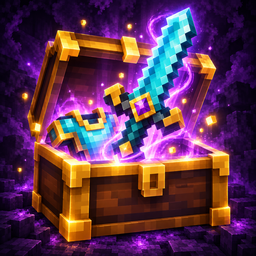

# Mythic Loot

<p align="center"></p>

Mod de Fabric para **Minecraft Java 26.3**: los mobs hostiles que matás pueden soltar **armas, arcos, armaduras, escudos y herramientas con rareza y afijos** al azar. Más daño, robo de vida, flechas certeras, más vida, más armadura… Cuanto más nivel tiene el mob, mejor es lo que suelta.

Pensado para jugarse con **Bloodmoon & Bosses** (los mobs con niveles) y **Hero's Forge** (las estadísticas que se compran con experiencia): Bloodmoon hace más fuertes a los mobs, Hero's Forge te hace más fuerte a vos, y Mythic Loot hace que el equipo siga mejorando más allá de la netherita con Filo V.

## Cómo funciona

### Cuándo se suelta

- **Sólo si lo mataste vos** (o lo remató la caída o el fuego después de tu golpe, como el loot de vanilla), y con `/gamerule mobDrops` prendida.
- **La chance crece con el nivel del mob:** 2 % más 0,08 % por nivel, hasta 10 %. Un mob de nivel 50 suelta algo una de cada 16 veces; uno de nivel 100, una de cada 10.
- **Con Bloodmoon & Bosses:**
  - el nivel es el del mob ("Zombi [Nv 57]");
  - **los campeones tienen el doble de chance**;
  - **los jefes de zona sueltan siempre un objeto épico o mejor**, y uno de cada cuatro trae un **afijo de jefe** (ver abajo);
  - los mobs sin nivel (de spawners, huevos o comandos) no sueltan nada: las granjas no cambian.
- **Sin Bloodmoon:** sueltan los mobs hostiles, con un nivel por la distancia al spawn del mundo (1 cada 100 bloques, ×8 en el Nether, +20 en el Nether y +40 en el End).
- Las épicas y legendarias caen **brillando** (se ven a través de las paredes), con un sonido y un "¡Botín épico!" en pantalla.

### Rarezas

| Rareza | Color | Afijos | Desde el nivel | Peso |
|---|---|---|---|---|
| Mágica | azul | 1 | 1 | 60 |
| Rara | amarillo | 2 | 20 | 30 |
| Épica | violeta | 3 (+10 %) | 50 | 12 |
| Legendaria | dorado | 4 (+25 %) y brilla | 80 | 4 |

Entre las que ya pueden salir, se sortea por peso: en el nivel 100 sale una legendaria cada ~26 objetos.

### Qué objeto

| Tipo | Objetos |
|---|---|
| Cuerpo a cuerpo | espada, hacha o lanza; **desde épica, también maza** |
| A distancia | arco o ballesta |
| Armadura | casco, peto, pantalones o botas |
| Tridente | tridente |
| Escudo | escudo: sus afijos valen con el escudo en la **mano secundaria** |
| Herramienta | pico o pala |

- **El material depende del nivel** (en las espadas, hachas, lanzas, armaduras, picos y palas): cobre hasta el 19, hierro (cadena en armadura) hasta el 39, hierro hasta el 59, diamante desde el 60. **Netherita sólo las legendarias de nivel 80 o más.**
- No salen encantados: se encantan en la mesa como cualquier otro. Se pueden renombrar y reparar en el yunque sin perder los afijos.
- **Se pueden juntar en el yunque** (ver abajo).

### Afijos

El nombre lleva el afijo principal: **"Espada de diamante del Vampiro"**. El tooltip muestra la rareza, el nivel y cada afijo: los que son atributos los muestra Minecraft solo. Si el objeto ya trae ese atributo, el afijo se le suma: un peto de hierro "de la Fortaleza" muestra una sola línea, "Armadura: +6.5", y no "+6" y "+0.5" por separado.

| Afijo | Nombre | En | Qué hace | Al máximo (nivel 100, antes de la rareza) |
|---|---|---|---|---|
| Afilado | del Filo | cuerpo a cuerpo y tridentes | Daño | +6 |
| Furioso | de la Furia | cuerpo a cuerpo y tridentes | Velocidad de ataque | +20 % |
| Largo | del Alcance | cuerpo a cuerpo y tridentes | Alcance a mobs | +1 bloque |
| Vampírico | del Vampiro | armas, arcos y tridentes | Te cura una parte del daño que hacés (también con flechas y con el tridente lanzado) | 8 % |
| Ardiente | de las Llamas | armas, arcos y tridentes | Prende fuego al que golpeás, o las flechas | 5 segundos |
| Certero | del Halcón | arcos, ballestas y tridentes | Daño de las flechas y del tridente lanzado | +40 % |
| Ligero | del Viento | arcos, armaduras y herramientas | Velocidad | +6 % |
| Robusto | del Gigante | armaduras y escudos | Vida | +2 corazones por pieza |
| Reforzado | de la Fortaleza | armaduras y escudos | Armadura | +2 |
| Tenaz | del Coloso | armaduras y escudos | Dureza de armadura | +2 |
| Firme | de la Montaña | armaduras y escudos | Resistencia al empuje | +10 % |
| Afortunado | de la Suerte | armaduras y escudos | Suerte | +1 |
| Eficiente | del Minero | herramientas | Velocidad de minado, como Eficiencia (se suma al encantamiento) | +12 (entre Eficiencia III y IV) |
| Amplio | del Horizonte | herramientas | Alcance a bloques | +1,5 bloques |
| Submarino | de las Profundidades | herramientas | Velocidad de minado bajo el agua | +0,5 (la base es 0,2; Afinidad acuática la lleva a 1) |

- **El valor depende del nivel:** en el nivel 1 es un cuarto del máximo y llega entero en el 100. Cada objeto saca entre el 75 % y el 100 % de eso, y las épicas y legendarias rinden un 10 % y un 25 % más.
- **Las piezas de armadura se suman:** cuatro piezas "del Gigante" dan su vida juntas.
- El robo de vida no cura con el golpe que mata (como el de Hero's Forge).
- Certero y el daño a distancia de Hero's Forge se suman.
- **El tridente** usa sus afijos cuerpo a cuerpo y también lanzado: el certero sube los 8 de daño del tridente lanzado, y el ardiente prende al que le pega.
- **Los afijos del escudo** (vida, armadura…) cuentan sólo con el escudo en la mano secundaria, que es donde se usa.
- **Los de las herramientas** se suman a la rama Artesano de Hero's Forge (minado, alcance, minado submarino).

### Afijos de jefe

Cada especie de jefe de zona de Bloodmoon & Bosses tiene su afijo, que imita lo que hace ese mob. **Uno de cada cuatro objetos que suelta un jefe lo trae** (además de sus afijos comunes), y no sale de ningún otro lado. El objeto cae brillando, con un "¡Botín de jefe!", toma el nombre del afijo ("Peto de diamante del Vacío") y el afijo se ve en rojo en el tooltip.

| Jefe | Afijo | Qué hace | Al máximo (nivel 100) |
|---|---|---|---|
| Zombi | del Festín | Al matar un enemigo recuperás una parte de tu vida máxima | 10 % |
| Esqueleto | de la Lluvia | Chance de que cada flecha salga con otra más (que no se puede juntar) | 30 % |
| Vindicador | del Verdugo | Tus golpes ignoran parte de la armadura del enemigo | 30 % |
| Bruja | del Brebaje | Al recibir daño, chance de tomar un brebaje como la bruja: resistencia al fuego si te quemás, respiración bajo el agua y, si no, curación instantánea. Uno cada 20 segundos | 30 % |
| Esqueleto del Wither | del Marchitamiento | Tus golpes dan Wither II | 4 segundos |
| Piglin bruto | del Bruto | Recibís menos daño cuerpo a cuerpo | −20 % |
| Blaze | de la Llamarada | Recibís menos daño de fuego y lava, y el que te pega cuerpo a cuerpo se prende fuego (4 segundos) | −50 % |
| Enderman | del Vacío | Chance de esquivar un ataque teletransportándote hasta 8 bloques, como con la fruta de chorus. Uno cada 5 segundos | 20 % |

- **Sale en cualquier tipo de objeto** y vale mientras lo tenés equipado en su lugar: el arma o la herramienta en la mano, el escudo en la mano secundaria, la armadura puesta. Un casco "del Verdugo" también hace que tus golpes ignoren armadura. En el inventario no hace nada.
- **No se apilan:** con dos objetos que traen el mismo, cuenta el más alto.
- **No ocupa lugar:** una épica de jefe tiene sus 3 afijos más el de jefe. El valor depende del nivel, como los otros.
- El vacío esquiva ataques de algo (un mob, una flecha, otro jugador), como la esquiva de Hero's Forge: la lava, las caídas y el vacío entran igual. Si no encuentra dónde caer, el golpe entra.
- `/mythicloot generar <nivel> <rareza> <tipo> <afijo>` da un objeto con un afijo de jefe, para probarlo.

### Juntar en el yunque

Dos objetos iguales con afijos (dos espadas de cobre, dos cascos de hierro…) se juntan en el yunque como en vanilla, y **el resultado se queda con los afijos de los dos**:

- "Espada de cobre del Filo" + "Espada de cobre de la Furia" = una espada **rara** con daño y velocidad de ataque. Se queda con el nombre del de la izquierda.
- **La rareza sube según cuántos afijos tenga:** 2 rara, 3 épica, 4 legendaria. Más de 4 no entran: se quedan los del de la izquierda.
- **Si los dos tienen el mismo afijo, queda el valor más alto** (no se suman).
- **El afijo de jefe se conserva** y no cuenta para el tope de 4 ni para la rareza, pero hay uno solo por objeto: si los dos traen uno distinto, queda el del de la izquierda.
- El nivel es el más alto de los dos. La durabilidad y los encantamientos se juntan como siempre.
- **Cada afijo que gana o mejora cuesta 4 niveles**, además de lo que cobre vanilla por reparar o encantar. Si no gana nada, es un yunque común.

## Comandos (op)

| Comando | Qué hace |
|---|---|
| `/mythicloot generar <nivel> [rareza] [tipo] [afijo]` | Te da un objeto con afijos de ese nivel. `rareza`: `magica`, `rara`, `epica`, `legendaria` (si no va, al azar); `tipo`: `cuerpo_a_cuerpo`, `a_distancia`, `armadura`, `tridente`, `escudo`, `herramienta`; `afijo`, uno de jefe: `festin`, `lluvia`, `verdugo`, `brebaje`, `marchito`, `bruto`, `llamarada`, `vacio` |
| `/mythicloot recargar` | Vuelve a leer `config/mythicloot.json` sin reiniciar el servidor |

## Configuración

En el primer arranque se crea **`config/mythicloot.json`** con los valores por defecto. Editalo y usá `/mythicloot recargar`, o reiniciá el servidor.

**Desde el juego, con [Mod Menu](https://modrinth.com/mod/modmenu):** en la lista de mods, el botón de configuración de Mythic Loot abre una pantalla con todas estas opciones, con su nombre y una ayuda al pasar el mouse. Al guardar se aplica enseguida, como con `/mythicloot recargar`. Si un valor no sirve, no se guarda nada y la pantalla dice por qué. Edita el archivo de tu instalación: sirve en singleplayer, en un mundo abierto en LAN desde tu juego y para preparar la config antes de crear un mundo. El de un servidor dedicado se sigue editando en el servidor.

- Si el archivo tiene un error (JSON mal escrito o un valor imposible), se queda la configuración que había, el archivo no se toca y el error aparece en el chat y en la consola.
- Si falta una clave se usa su valor por defecto, y al leer el archivo se reescribe completo. Una clave que no existe se ignora con un aviso en la consola.
- Los objetos que ya se soltaron no cambian: sus valores quedan guardados en cada uno.

| Clave | Por defecto | Qué hace |
|---|---|---|
| `nivelMaximo` | 100 | El nivel en que los afijos llegan a su máximo |
| `bloquesPorNivel`, `extraNether`, `extraEnd` | 100, 20, 40 | Sin Bloodmoon: cómo se calcula el nivel por la distancia |
| `chanceBase`, `chancePorNivel`, `chanceMaxima` | 0.02, 0.0008, 0.10 | La chance de soltar algo, de 0 a 1 |
| `multiplicadorCampeon` | 2.0 | Por cuánto se multiplica la chance de un campeón de Bloodmoon |
| `botinDeJefe`, `rarezaDeJefe` | `true`, `"epica"` | Si los jefes de zona sueltan siempre, y la rareza mínima |
| `afijosDeJefe` | ver arriba | `chance` (0.25) de que el objeto de un jefe traiga el afijo de su especie; `porMob`, el afijo de cada especie por id (`"minecraft:zombie": "festin"`; `""` es ninguno, y se pueden sumar especies que un datapack agregue a los jefes de Bloodmoon); `nivelDeMarchito` (2 = II), `segundosDeBrebaje` (lo que dura la resistencia al fuego o la respiración), `segundosEntreBrebajes`, `segundosDeLlamarada`, `segundosEntreTeletransportes`, `distanciaDeTeletransporte` |
| `rarezas` | ver arriba | Por rareza (`magica`, `rara`, `epica`, `legendaria`): `nivelMinimo` y `peso` |
| `pesosDeTipo` | 40, 20, 40, 5, 8, 12 | Cuánto sale cada tipo: `cuerpo_a_cuerpo`, `a_distancia`, `armadura`, `tridente`, `escudo`, `herramienta` |
| `nivelesPorMaterial` | 20 | Cada cuántos niveles mejora el material |
| `netheritaSoloLegendaria` | `true` | Si la netherita sólo sale en legendarias |
| `rarezaMinimaDeMaza` | `"epica"` | Desde qué rareza un arma cuerpo a cuerpo puede ser una maza |
| `costoPorAfijoUnido` | 4 | Los niveles que cobra el yunque por cada afijo que gana o mejora un objeto |
| `idioma` | `"en_us"` | `en_us` o `es_ar`: el de los nombres y el lore de los objetos que se generan, para quien no tiene el mod en el cliente. Con el mod instalado en el cliente, cada uno los ve en su idioma. Los mensajes del chat salen siempre en el idioma de cada jugador |
| `valoresMaximos` | ver la tabla de afijos | Lo que vale cada afijo en el nivel máximo: los porcentajes como fracción (`0.08` = 8 %), el fuego en segundos |

## Funciona con

- **Bloodmoon & Bosses** (recomendado): el nivel del botín es el del mob, los campeones tienen el doble de chance y los jefes de zona sueltan siempre una épica o mejor, a veces con el afijo de su especie. Los mobs de spawners no sueltan nada. Sin Bloodmoon no hay jefes, y por eso tampoco afijos de jefe.
- **Hero's Forge:** el robo de vida y el daño a distancia de sus estadísticas se suman a los afijos. Su esquiva y el vacío se tiran por separado, y sus resistencias se suman al bruto y a la llamarada.
- **Soul Link:** no se tocan. Con la vida compartida, lo que cura el festín o el brebaje le llega a todo el grupo, y un golpe que el vacío esquiva no le baja la vida a nadie.
- **[Mod Menu](https://modrinth.com/mod/modmenu)** (opcional, en el cliente): la configuración se edita desde el juego. Ver [Configuración](#configuración).

## Requisitos e instalación

Minecraft Java 26.3, [Fabric Loader](https://fabricmc.net/use/) 0.19.5 o más nuevo, [Fabric API](https://modrinth.com/mod/fabric-api) y Java 25. Toda la lógica corre en el servidor; en el cliente, el mod sólo suma la pantalla de Mod Menu.

- **Servidor:** copiá `mythicloot-<versión>.jar` y Fabric API a `mods/`. Los jugadores no necesitan nada: los objetos usan componentes de vanilla.
- **Singleplayer o LAN:** en el cliente del que abre el mundo, junto con Fabric API.

## Desarrollo

```bash
./gradlew build          # compila y corre las pruebas; el jar queda en build/libs/
./gradlew runGameTest    # sólo las pruebas automáticas, en un servidor sin ventana
./gradlew runClientGameTest   # la pantalla de configuración en un cliente de verdad (abre una ventana)
```

Pide Java 25: si Gradle no encuentra tu JDK, agregá `org.gradle.java.installations.paths=<ruta a tu JDK 25>` a tu `~/.gradle/gradle.properties`. La documentación técnica está en [CLAUDE.md](CLAUDE.md).

## Licencia

[MIT](LICENSE).
